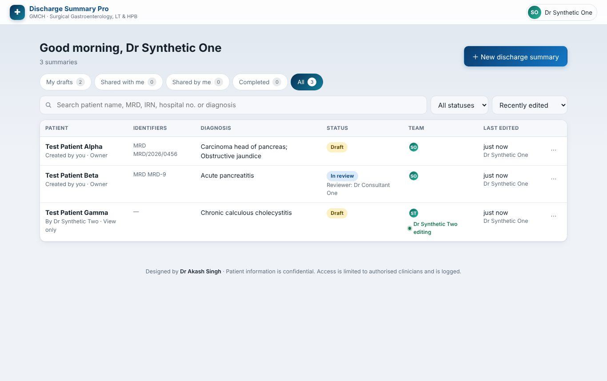
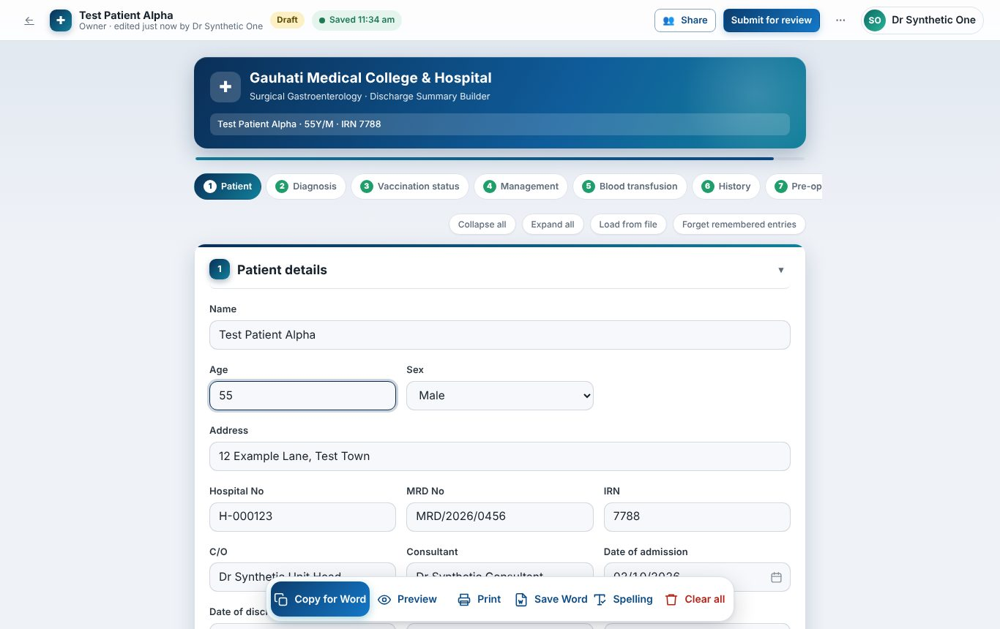

# Discharge Summary Pro

Multi-doctor discharge summary application for **Surgical Gastroenterology, Liver Transplantation & HPB,
Gauhati Medical College & Hospital (GMCH), Guwahati**.

**Designer of the clinical form:** Dr Akash Singh. The doctor-designed form, its clinical content and its
Word/print output are preserved exactly; this version adds secure sign-in, server-side drafts with
autosave, sharing between doctors, review/finalisation and an audit trail.

> Use synthetic data until the hospital has approved processing of identifiable patient information
> (see [docs/SECURITY.md](docs/SECURITY.md) §8).

## Contents

* [How it works](#how-it-works) · [Roles](#roles) · [Using the application](#using-the-application)
* [Setup and deployment](#setup-and-deployment) · [Development](#development) · [Known limitations](#known-limitations) · [Troubleshooting](#troubleshooting)
* Detailed documents: [Analysis & inventory](docs/ANALYSIS.md) · [Architecture](docs/ARCHITECTURE.md) ·
  [Security](docs/SECURITY.md) · [Deployment](docs/DEPLOYMENT.md) · [Testing](docs/TESTING.md) ·
  [Feature preservation](docs/FEATURE-PRESERVATION.md)





## How it works

| Layer | Technology |
|---|---|
| Frontend | The original HTML/CSS/JavaScript form engine + small ES modules (no framework, no bundler) |
| Hosting | Vercel (static files, security headers) |
| Sign-in | Supabase Auth (email + password, invitation only) |
| Data | Supabase PostgreSQL with Row Level Security and server-side API functions |
| Privileged admin tasks | One Supabase Edge Function (`admin-users`) |

The original clinical form runs inside `editor.html`. Instead of keeping one draft in the browser, it now
saves each summary to the hospital's Supabase database, in exactly the same data format.

## Roles

Permissions are configured by administrators in **User administration** and enforced by the database.

| Role | Default permissions |
|---|---|
| **Doctor** | Create summaries, edit own and shared drafts, share, submit for review, export |
| **Consultant / Reviewer** | Everything a doctor can do, plus review, approve or return, approve own drafts, finalise |
| **Administrator** | Invite, activate/deactivate users, change roles and role permissions, see non-clinical statistics. **No access to patient records** unless explicitly configured |

## Using the application

**Create a summary.** Dashboard → **New discharge summary**. The form is the original one: same sections,
suggestions, medicine pop-up, keyboard shortcuts.

**Autosave.** Changes are saved about 2–3 seconds after you stop typing. The status at the top shows
*Unsaved changes → Saving… → Saved hh:mm*. If the connection drops it shows *Offline* and keeps your changes
in this browser tab, retrying automatically; it never shows *Saved* until the server has them. **Ctrl+S**
saves immediately and creates a History checkpoint. If the tab is closed or crashes with unsent changes,
reopening the summary offers to restore them.

**Resume work.** Dashboard → *My drafts* (or *All*). Search by patient name, MRD, IRN, hospital number or diagnosis.

**Share a draft.** Open it → **Share** → search a colleague → *View only* or *Can edit* → add. They see it
under *Shared with me*. Change or remove access in the same dialog. Use ⋯ → *Make a copy* only if you want a
separate document.

**Continue another doctor's draft.** Only one doctor edits at a time. If a colleague is editing you see
"*Dr X is editing this summary*" and a read-only view; use **Take over editing** if needed (their unsaved
changes stay in their browser and they are told). Editing is released automatically when a tab is closed or
left idle for 20 minutes.

**Review and approval.** Author → **Submit for review** → choose a consultant (pre-submission checks list
anything missing). The summary becomes read-only. The consultant opens it from *Pending review* →
**Approve** or **Return for correction** with a note. After approval → **Finalize** (checklist required).
Finalised summaries cannot be edited; use **Create amendment** to make a traceable corrected version.
Consultants can also approve their own drafts directly.

**History.** ⋯ → *History and activity*: versions (download/restore) and who did what.

**Export and import.** *Copy for Word*, *Preview*, *Print* (A4) and *Save Word* work as before.
*Load from file* restores a `.docx` saved by this application exactly (it contains the form data);
any other Word/HTML file is read best-effort and you are asked to check labs, medicines and dates.
⋯ → *Download form data (.json)* gives a backup that *Load from file* also accepts.

### Keyboard shortcuts
Ctrl+Enter Copy for Word · Ctrl+P Print · Alt+V Preview · Alt+W Save Word · Alt+S Spelling ·
Alt+↑/↓ jump between sections · Enter next field · **Ctrl+S save now** (new) · **/** search on the dashboard (new).

### Print / Word text sizes
| Part | Size |
|---|---|
| Hospital header | 16 pt |
| Department lines | 13 pt |
| Title "DISCHARGE SUMMARY" | 14 pt |
| Section headings (underlined) | 12 pt |
| Body | 11 pt |
| Page footer | 9 pt |

## Setup and deployment

Full steps: **[docs/DEPLOYMENT.md](docs/DEPLOYMENT.md)**. In short:

1. Create a Supabase project → `supabase link` → `supabase db push` (applies `supabase/migrations`).
2. In Supabase Auth: turn sign-ups **off**, set Site URL and redirect URL `https://<domain>/reset.html`, configure SMTP.
3. `supabase secrets set ALLOWED_ORIGINS=https://<domain>` → `supabase functions deploy admin-users`.
4. Import the repo in Vercel; set `SUPABASE_URL` and `SUPABASE_PUBLISHABLE_KEY` (publishable/anon key only)
   for Production and, pointing at a staging project, for Preview. Deploy.
5. Create the first administrator (DEPLOYMENT.md §4) and invite doctors from *User administration*.

| Environment variable | Purpose |
|---|---|
| `SUPABASE_URL` | Project URL |
| `SUPABASE_PUBLISHABLE_KEY` | Publishable (anon) key. The build fails if a secret key is supplied |
| `DSP_RECOVERY_CACHE` | `session` (default), `off`, or `local` (needs approval) |
| `DSP_IDLE_SIGNOUT_MINUTES` | Default 120; 0 disables |
| `DSP_EDIT_IDLE_RELEASE_MINUTES` | Default 20 |

**Backups:** Supabase daily backups + Point-in-Time Recovery for production; each summary also keeps its own
version history. **Rollback:** promote the previous Vercel deployment; database changes are forward-only
migrations (DEPLOYMENT.md §7).

## Development

```bash
npm install
cp .env.example .env && set -a && . ./.env && set +a
npm run dev                   # http://127.0.0.1:5173
npm run test:unit && npm run test:db && CHROME_PATH=/path/to/chrome npm run test:e2e
```

```
app/          static site: editor.html (original form), index/login/reset/admin pages, css, js, vendor
  css/form.css, js/form-engine.js   ← the original stylesheet and script (8 small marked patches)
supabase/     migrations (schema, RLS, API), Edge Function, local config
scripts/      build (public config + key guard + CSP check), static server, vendor refresh
tests/        unit, db (real PostgreSQL), e2e (Playwright: regression vs original + application)
original/     the three source files supplied, kept for reference and regression testing
docs/         analysis, architecture, security, deployment, testing, feature preservation
```

## Known limitations

* Needs an internet connection to open summaries; while editing, short outages are handled (offline queue).
* One active editor per summary (by design); simultaneous co-editing is not supported.
* Importing Word files not produced by this app is best-effort and must be checked.
* Validation rules and the finalisation checklist are suggestions awaiting clinical sign-off (docs/ANALYSIS.md §8).
* Tested automatically in Chromium; Safari and Firefox should be checked manually before go-live.
* Invitation/reset e-mails and the Edge Function require a configured Supabase project to test.

## Troubleshooting

| Symptom | Cause / fix |
|---|---|
| "This deployment is not configured yet" | Set `SUPABASE_URL` and `SUPABASE_PUBLISHABLE_KEY` in Vercel and redeploy |
| "Your account is not active" | An administrator must activate the account (User administration) |
| Invitation / reset link says invalid or expired | Request a new one; check the redirect URL in Supabase Auth settings |
| *Offline · kept in this browser tab* | Connection lost; keep the tab open, it retries automatically or click the status to retry |
| "Dr X is editing this summary" | Wait, or use *Take over editing* |
| *Conflict detected* | Someone saved a newer version; reload — your changes are offered for restore or download |
| Save as Word downloads nothing on a phone | The share sheet opens instead; choose Files/Drive |
| Spelling shows only grammar items | The dictionary file did not load; reload the page |
